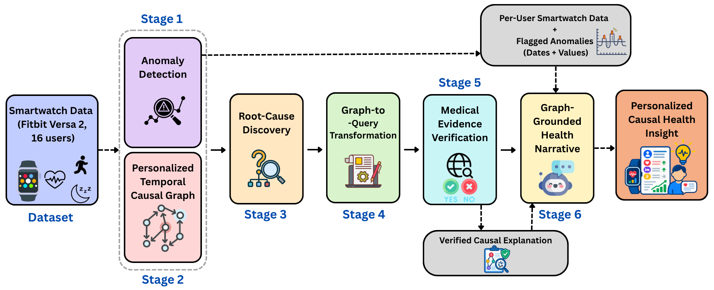
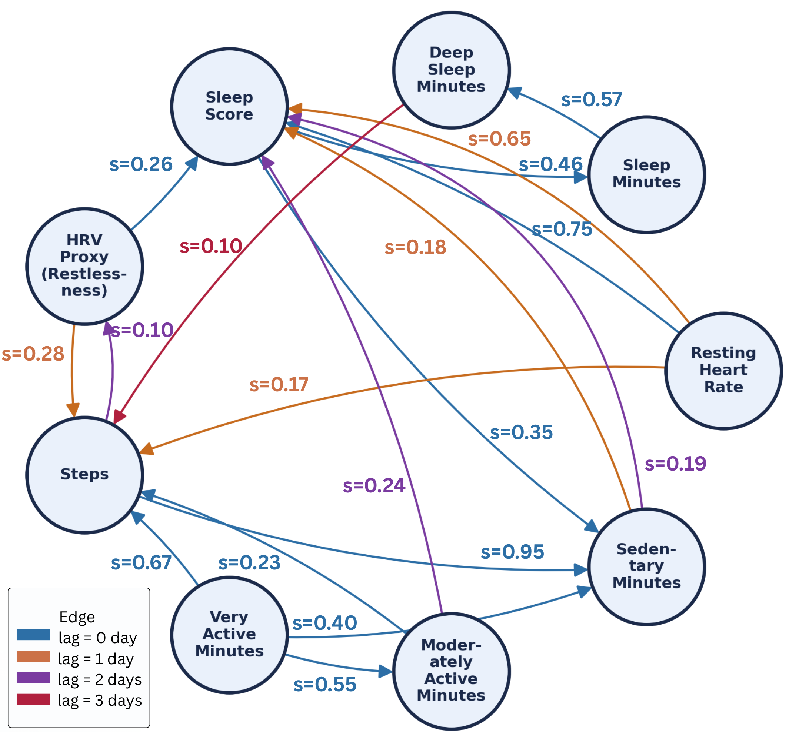
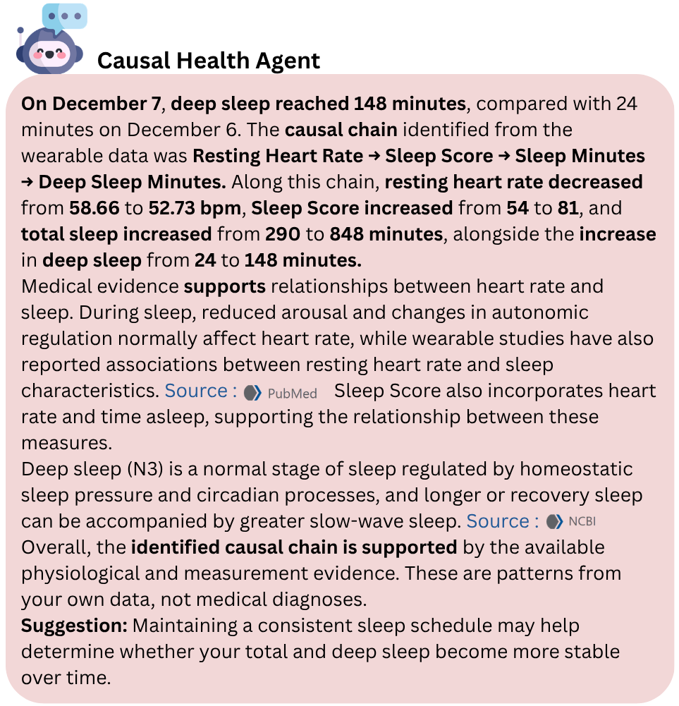

# Causal Health Agent

**From Wearable Sensor Anomalies to Evidence-Grounded Explanations**
Farnaz Sadat Mirnezami, Heidar Davoudi, Ali Neshati, Ontario Tech University

Smartwatches tell you *what* changed (resting heart rate rose, sleep dropped). Causal Health Agent
asks *what may have contributed*, *how did it evolve over time*, and *is there medical evidence for it?*
It detects personal anomalies, builds a participant-specific **lag-aware causal graph**, ranks the
upstream pathways, **verifies them against trusted medical sources**, and only then lets an LLM write a
plain-language narrative. LLMs are **never** used for anomaly detection, causal discovery or root-cause
ranking: they only formulate queries (Stage 4), assess retrieved evidence (Stage 5) and narrate verified
findings (Stage 6).


*Fig. 1: Stages 1 and 2 run in parallel; Stage 3 combines them; Stages 4-5 turn the selected causal path into a verified explanation; Stage 6 narrates it.*

## Stages and code

| # | Stage | What it does | Module |
|---|---|---|---|
| - | Preprocessing | PMData to one daily table per participant, 9 smartwatch features; fixes 4 data-quality issues (0-bpm sentinel, bad timestamps, duplicate rows, stray whitespace); missing days flagged, never imputed | `preprocess.py` |
| 1 | Anomaly detection | 10 detectors: Z-score, AR, ARIMA, **SARIMA (default)**, Isolation Forest, Chronos, LSTM, Autoencoder, LSTM-AE, simplified TranAD. Sliding 14-day (30 for SARIMA) windows; neural models train on the first 50% of history. One flag per day **per feature** | `stage1_anomaly.py` |
| 2 | Personalised causal graph | **VARLiNGAM (default)**, Granger (FDR), PCMCI, DYNOTEARS and a Pearson baseline; per participant, edges carry lag 0-3 days, strength, significance | `stage2_causal_graph.py` |
| 3 | Root-cause ranking | DFS ancestor subgraph, simple-path enumeration and the **Root-Cause Ranking Score** (Eq. 1) | `stage3_root_cause.py` |
| 4 | Graph-to-query | Template, Multi-hop, LLM-based, Graph-aware, **ReAct + Graph-aware (default)** | `stage4_queries.py` |
| 5 | Evidence verification | Tavily search limited to 16 trusted medical domains, LLM verdict: *supported / contradicted / inconclusive*, ReAct refinement | `stage5_verification.py` |
| 6 | Narrative | Constrained narrative from 5 LLMs via OpenRouter; fixed "not a diagnosis" closing | `stage6_narrative.py` |
| Eval | Paper evaluations | Tables II-IV (agreement, P/R/F1, stability, convergence, root-cause consistency), RAGAS (Table VI), LLM-as-judge rubric (Tables VIII-IX) | `evaluation/` |

### Root-Cause Ranking Score (Stage 3)

For a path P = (v0 -> v1 -> ... -> vL), with edge strength w_i and lag l_i, and w~_i = |w_i| / max over all edges of the participant's graph:

```
RCRS(P) = (1/L) * sum_{i=1..L}  w~_i / (1 + l_i)
```

Stronger edges raise the score; longer delays and longer paths lower it. A candidate root's score is its best path.

## Quick start

```bash
pip install -r requirements.txt
python -m pytest -q tests                      # offline tests, no keys or data needed

python run_pipeline.py --synthetic --fast      # smoke test on synthetic data
python run_pipeline.py --data-root /path/to/PMData        # Stages 1-3 on real data (no LLM)
```

Expected PMData layout (`<root>/p01/fitbit/*.json|csv`, `<root>/p01/pmsys/`, ...). Results are written to `outputs/`
(`stage1_flags_<pid>.csv`, `stage1_anomalies.csv`, `stage2_edges.csv`, `graph_<pid>.png`, `stage3_results.csv`).

### Stages 4-6 (LLMs, needs API keys)

Keys are read **only from environment variables**; nothing is stored in the repo (`.env` is git-ignored, see `.env.example`).

```bash
export OPENROUTER_API_KEY=...   TAVILY_API_KEY=...
python run_pipeline.py --data-root /path/to/PMData --llm --max-cases 15
python run_pipeline.py --data-root /path/to/PMData --llm --strategy graph_aware   # compare query strategies
python run_pipeline.py --data-root /path/to/PMData --llm --ablation stage5        # Table IX variants
```

Runs checkpoint to `outputs/` and resume if interrupted. Model names are configured in `causal_health_agent/config.py`.

### Reproducing the evaluations

```bash
python run_pipeline.py --data-root /path/to/PMData --evaluate stage1 stage2 stage3
```

## Using the modules directly

```python
from causal_health_agent import preprocess as pp, stage1_anomaly as s1, stage2_causal_graph as s2, stage3_root_cause as s3

frame  = pp.build_daily_dataframe("PMData/p01", "p01")
flags  = s1.run_stage1(frame, detectors=["sarima"])           # day x (detector, feature) booleans
edges  = s2.discover(frame, "varlingam")                      # [{source, target, lag, strength, pvalue}]
G      = s3.build_graph(edges)
pick   = s3.select_root_cause(G, "resting_hr")                # top-ranked causal path
```

## Example output

<p align="center"> </p>

*Left: VARLiNGAM graph for participant p01 (colour = lag, label = effect strength). Right: a generated, evidence-grounded explanation.*

## Notes and limitations

- Hyper-parameters the paper does not state are marked `ASSUMPTION` in `causal_health_agent/config.py` (Z-score threshold 2.5, VARLiNGAM edge cut-off 0.15, ...).
- OpenRouter model slugs (especially Qwen3.7-Max) must be checked against your account; the paper names models, not slugs.
- No ground-truth causal graphs exist for PMData: discovered pathways are **data-driven hypotheses, not clinical conclusions**. Stage 3's evaluation measures ranking self-consistency (the reference graph is itself RCRS-ranked).
- Edges among derived or time-budget-sharing features (sleep score, activity minutes) can reflect measurement construction rather than physiology.
- Neural detectors calibrate their threshold on a held-out slice of the first 50% of history; on real PMData the autoencoder-family models still flag more days than the paper's Table II, so treat their numbers as indicative.
- The Chronos detector and the RAGAS evaluation need optional dependencies and are not covered by the offline tests.

## Citation

If you use this code, please cite the paper: *Causal Health Agent: From Wearable Sensor Anomalies to Evidence-Grounded Explanations* (Mirnezami, Davoudi, Neshati).
